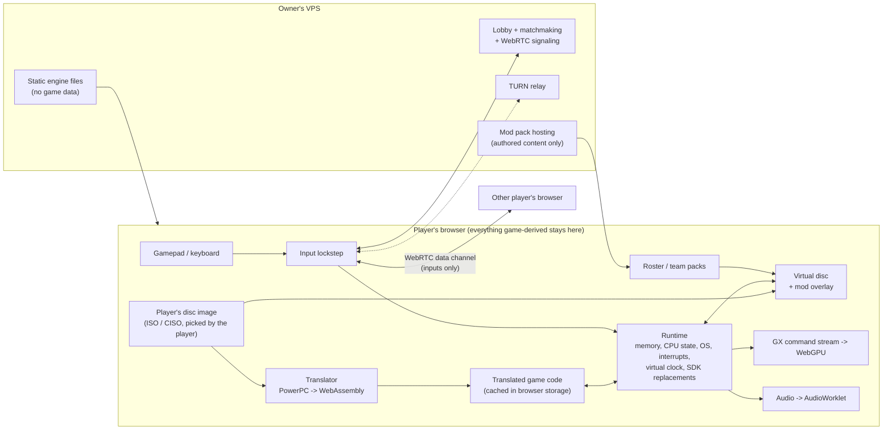

# Engine architecture

How MVP Baseball 2005 runs in a browser, plays online and takes roster and team mods.
The goal and the milestones are in [`ROADMAP.md`](ROADMAP.md). This file is the design.
The decisions it relies on are recorded in [`DECISIONS.md`](DECISIONS.md) (2026-10-14).

## 1. Overview

The browser runs the **retail game code**, translated from PowerPC to WebAssembly
on the player's own machine. A runtime provides everything the console and the
Nintendo SDK provided. Mods and netplay plug into interfaces that never change.

## 2. The three contracts

Mods and netplay depend only on these. None of them changes when the decomp
progresses, so no mod ever needs rework because of decomp work.

| Contract | What it is | Why it never moves |
|---|---|---|
| **Retail binary** | The code and addresses of `main.dol` (GV4E69 rev 0, SHA-1 `da6becdb...`) and its overlay files. Code hooks target retail addresses. | The disc never changes. The decomp only *names* these addresses |
| **Game data formats** | The files and database tables the game reads: `database.big` tables, BIG archives, textures, layouts. Roster and team packs are patches against them. | Defined by the shipped game, not by our source |
| **Engine APIs** | The engine's mod-pack format, hook API and netplay protocol. | We own them and version them (semantic versioning, with a compatibility test suite) |

Mods are never written against decomp source layout or placeholder names. A
hook can carry the decomp's name for its address as a label, but the address is
what binds.

## 3. What stays private

- **Never committed, never published:**
  - the disc image and anything read or derived from it: translated code, extracted
    or converted files, decompressed overlays;
  - memory dumps, save states, and screenshots or recordings of the game.
- **The player's browser produces these locally** from the player's own disc and
  keeps them in its own storage (OPFS). Development builds do the same in `build/`.
- **The VPS serves only:**
  - the engine (our code);
  - on the owner's deployment only (owner, 2026-10-14), the owner's disc image, behind the
    player link, to the owner and invited players who own the game. The page then loads the
    disc from there instead of the file picker. The site itself is open (owner, 2026-10-20):
    anyone else picks their own image;
  - on the owner's deployment only (owner, 2026-10-20), the owner's own save states, to the
    owner alone (the admin link), stored gzipped on the owner's server;
  - the lobby, signaling and TURN relay;
  - mod packs that contain authored content or deltas, never copies of retail files.
- The engine checks the disc's identity (GV4E69 rev 0) by hash before it runs anything.

## 4. Translator (`engine/translator/`)

**Input:**
- the DOL from the player's disc;
- function boundaries, jump tables and names from the decomp's `config/GV4E69/`
  (`symbols.txt`, `splits.txt`), which is metadata, not game data. The engine reads
  them only from its own pinned copy, `engine/decomp_pin/`, which changes only through
  `engine/tools/sync_decomp_pin.py` (DECISIONS, 2026-10-27).

**Output:** one WebAssembly module, plus a table that maps guest addresses to functions.

- **The code is static.** There are no REL modules and no self-modifying code. The
  code overlays (`.frontend_codeoverlay` at 0x8043FDC0, `.database_codeoverlay` at
  0x8052A220) are in the DOL, *and* the game reloads them at runtime from
  `/data/ovlay.big` (RefPack-compressed; they unpack to exactly the DOL section
  sizes). So the translator translates the DOL image. When the game invalidates
  the instruction cache over an overlay range, the runtime checks that the bytes it
  loaded hash to the translated image; any mismatch is a hard error. The disc also
  carries `ovlay_d.big` and `ovlay_m.big`, different and larger builds of the same
  overlays. Retail code doesn't reference them by name, so we don't translate them.
- **Indirect calls** (vtables, function pointers, `bctrl`/`blrl`) go through a
  guest-address dispatch table.
- **Gekko specifics:**
  - paired singles;
  - single-precision rounding (`frsp` and single ops) and fused multiply-add semantics;
  - CR, XER and carry;
  - `dcbz` zeroes 32 bytes; other cache operations are no-ops except the overlay check;
  - `lwarx`/`stwcx.` (single core, so simple);
  - `mftb` reads the *virtual* time base;
  - stores to the write-gather pipe (0xCC008000) feed the GX command buffer;
  - other memory-mapped I/O goes to runtime handlers.
- **Interrupts** (decrementer, VI, DVD, DSP/AI, SI) are delivered at safe points:
  function entries and loop back-edges. When they fire is decided by the virtual
  clock, never by wall time.
- Whether we adopt, fork or write the translator is decision **D1**; the backend
  and where it runs are **D2** (§9).

## 5. Runtime (`engine/runtime/`)

- **Memory:**
  - MEM1 (24 MB, mirrored at 0x80000000 cached and 0xC0000000 uncached) and ARAM
    (16 MB) live in WebAssembly linear memory;
  - guest memory stays **big-endian**, with byte-swapped accesses, so data files,
    save states and memory hashes look the same on every machine (D8).
- **CPU state:** GPRs, FPRs (including paired-single halves), CR, XER, LR, CTR,
  GQRs and the SPRs the game uses.
- **OS:** the game's threads (for example the memory-card thread) become
  cooperative contexts. The runtime switches them at safe points, the way the
  single-core console would (D4).
- **Virtual clock:** time advances with emulated work and frames, never with the
  host clock. `OSGetTime`, `OSGetTick`, `mftb`, alarms and the decrementer all
  read it.
- **SDK replacements (HLE):** each SDK function the game calls is replaced *by
  name* with a host implementation. That is why knowledge target K1 (`ROADMAP.md`)
  names every one of them.

  | SDK area | Replaced by |
  |---|---|
  | DVD | Virtual disc reads, completed at deterministic virtual times |
  | PAD / SI | The input layer (local pad or netplay lockstep) |
  | VI | Frame boundary and pacing (59.94 Hz NTSC) |
  | CARD | Not replaced: the SDK's CARD code drives an emulated flash card in slot A (`runtime/memcard.h`), kept in browser storage |
  | AI / AX / DSP / AR / ARQ | Audio and ARAM, see §7 |
  | GX | Setup calls go through; the command stream goes to the renderer (§6) |
  | OS (threads, alarms, interrupts, heap/arena) | The runtime's scheduler and clock |

## 6. Renderer (`engine/gfx/`)

- The renderer consumes the **GX command stream** (CP, XF and BP register writes,
  draw commands, display lists), not GX function calls. Game and EA code write
  vertices straight into the FIFO through inlined GX macros (D6).
- **WebGPU** is used everywhere: in the browser, and through Dawn in native development builds.
- **Parts:**
  - TEV stages become generated WGSL shaders;
  - textures are decoded from GameCube formats (CMPR, I4/I8, IA4/IA8, RGB565,
    RGB5A3, RGBA8, C4/C8/C14X2 with TLUTs);
  - EFB copies become render-to-texture.
- 640x480 internal at first. Higher internal resolution and widescreen come later.

## 7. Audio (`engine/audio/`)

- The game uses Nintendo's AX library (the `dolphin/ax` units) under EA SND.
  Audio is replaced at the DSP command-list level (**D5**, decided in E3b). AX, EA SND and EA's CPU
  mixer stay retail code (`docs/engine/E3B_LOG.md`).
- Mixing runs on the virtual clock. Output goes to an AudioWorklet with a small
  resampling buffer.
- **Audio never feeds back into game state.** AX callbacks run on virtual time,
  so the speakers can't change what the game computes.

## 8. Disc, mods and netplay

### Virtual disc (`engine/vfs/`)
- Reads the player's image: ISO and CISO first (D7). Mounts mod packs over it by path.
- Decompresses BIG and RefPack only where a mod patch needs it. Otherwise the game
  reads its own files byte for byte.

### Roster and team packs (`engine/mods/`)
- **A pack is a manifest plus content:**
  - the manifest: `pack.json` with id, version, the game id `GV4E69-0`, the engine
    API version and dependencies;
  - **table patches** to the database (`/data/database/database.big`): set or
    replace fields of records by key, such as a player id or team id;
  - **authored asset files** mapped to game paths: logos, uniforms, load screens.
- **Patches are semantic and applied at load** to the tables from the player's own
  disc, so packs never contain retail files. Packs compose in a declared order.
- The tables are RefPack-compressed **text** (`docs/ROSTERS.md`), keyed by djb2 hashes of
  "Last,First" (players) and the 3-letter team code (teams).
  - A pack edits rows and columns by key.
  - A team pack keeps the slot's team code and changes only display fields.
  - Capacities are fixed in code: 3,250 players, 1,800 pitchers and 126 teams. The
    loader doesn't check them, so the pack validator must.
- **New teams replace existing slots.** There are 30 MLB teams plus 4 extra teams
  (MVP Legends, MVP Heroes and two Burnaby teams; see `GAME_DATA.md` §3). Adding
  *more* slots means code hooks, after K2 has inventoried every hard-coded team
  count and table capacity.
- **A pack's identity is a content hash.** Netplay requires both players to have
  the same packs in the same order.
- The data formats are in `docs/ROSTERS.md` (K2). The pack format (v1: manifest, operations,
  validation, conflict rules, hashing, versioning) is in `docs/MODDING.md`, versioned with the
  engine API; `tools/rosters/pack.py` is its reference implementation.

### Netplay (`engine/net/`, `engine/server/`)
- **Lockstep on inputs**, the way emulator netplay works. Each frame, each player's
  controller state is sent over a WebRTC data channel, with redundancy over
  unreliable delivery. A frame runs only when both players' inputs for it have
  arrived. Input delay is adjustable, 2-4 frames by default. Player 1 drives
  controller port 1, player 2 port 2.
- **Starts at power-on.** Both browsers boot the game identically and play from
  there, menus included. That needs no game knowledge. Jumping straight into a
  match by syncing a save state is a later improvement (needs K5).
- **The handshake refuses a game unless all of these are identical:** the engine
  build hash, the disc identity hash (both players own GV4E69 rev 0), the mod-pack
  list and its hashes, settings, and a shared seed for anything the engine itself
  randomizes.
- **The memory card** is empty or synchronized in netplay. Rosters come from packs,
  not saves.
- **Desync detection:** each side hashes MEM1 every 60 frames and compares. On a
  mismatch the game stops, and each player can keep a local diagnostic dump. That
  dump is game-derived, so it is never uploaded.
- **The VPS runs:**
  - static engine hosting;
  - a lobby with invite links and matchmaking;
  - a WebSocket signaling service;
  - a TURN relay (coturn) for players whose networks block direct connections.

  Input traffic is a few KB/s, so relaying is cheap.
- **Rollback comes later** (after E5). It needs fast state snapshots, built on K5.

## 9. Decisions

Lead decisions under the owner's 2026-10-14 delegation. Settled ones are also in
`DECISIONS.md`; open ones close at the milestone named.

| # | Question | Status |
|---|---|---|
| D1 | Adopt, fork or write the translator | **Decided (E0a, 2026-10-14):** write our own in C++20. One decoder and IR with a WebAssembly emitter (the product) and a C++ emitter (native development), plus a reference interpreter on the same semantics library. Every mature GameCube recompiler is GPL and none emits WebAssembly; `symbols.txt` already solves function discovery. Permissive pieces (gcn-recomp upstream MIT, pureikyubu CC0, Aurora MIT, N64Recomp MIT) are reused per `docs/engine/E0_SURVEY.md` §5 |
| D2 | Where translation runs, and what it emits | **Decided:** in the player's browser on first load, cached in browser storage (§3 requires it). The backend emits WebAssembly. A CLI build of the same translator serves development. Whether to emit one module or translate lazily per function is measured in E2 |
| D3 | Languages and toolchain | **Decided:** C++20 for the translator and runtime (Emscripten for the browser; clang or MSVC natively for development and tests); `webgpu.h` (Dawn natively, browser WebGPU under Emscripten); TypeScript for the web shell and the VPS services, so the protocol types are shared. Revisit only if D1 adopts a codebase in another language |
| D4 | How guest threads switch | **Chosen (E0a), confirmed by E0b item 9:** resumable guest threads on one host thread. A context switch unwinds to the dispatcher, and the target resumes at its guest PC, with the reference interpreter running what's left of the suspended frames. This keeps all state in guest memory plus the CPU context, so save states and rollback stay possible. Implemented in E0c: unwinding uses plain returns, and every call-return address and loop back edge is a resume label where native code re-enters. That gives 1 unwind per switch, with 0.01% of instructions interpreted Fallback if it costs too much: one host thread per guest thread with a baton (`E0_SURVEY.md` §6) |
| D5 | Audio replacement level | **Decided (E3b, 2026-10-14):** DSP command lists. Retail AX, EA SND and EA's CPU mixer keep running; the mixer is a read-only observer |
| D6 | Renderer input | **Decided:** the GX command stream (§6) |
| D7 | Disc image formats | **Decided:** ISO and CISO first; RVZ later |
| D8 | Guest memory byte order | **Decided:** big-endian, with byte-swapped accesses (§5) |

**Licensing:**
- `engine/` is our own code.
- Vendored code must be MIT, BSD, zlib, Apache-2.0 or CC0, recorded with its notice
  in `docs/REUSE.md`.
- GPL projects (Dolphin among them) are references to read, never sources to copy.
  Aurora's and the GameCube recompilers' licenses are checked in E0a.

## 10. Testing

- **Every engine component has unit tests that need no game data.** Examples:
  instruction semantics against hand-written vectors, texture decoders against
  synthetic textures, the netplay protocol against a simulated network. These run
  in CI.
- **Tests that need the disc run only on a machine that has it:** boot to the
  title screen, replay hashes, frame-time budgets. They skip cleanly elsewhere and
  never write their outputs into the repo.
- **Determinism is a test, not a hope** (E4). Replays must hash identically
  across runs, machines and browsers.

## 11. Layout (`engine/`)

| Path | Contents |
|---|---|
| `engine/translator/` | PowerPC decoder, function and jump-table recovery, WebAssembly emitter, CLI |
| `engine/runtime/` | Memory, CPU state, scheduler, virtual clock, interrupts, SDK replacements |
| `engine/gfx/` | GX command processor, TEV shader generation, texture decoding, WebGPU backend |
| `engine/audio/` | AX/DSP replacement, mixer, AudioWorklet bridge |
| `engine/vfs/` | Disc image readers (ISO, CISO), BIG/RefPack, mod overlay |
| `engine/mods/` | Pack format, table patcher, authoring CLI |
| `engine/net/` | Lockstep, input queue, desync detection, WebRTC client |
| `engine/web/` | Browser shell (TypeScript): disc picker, settings, lobby UI |
| `engine/server/` | VPS services (TypeScript): lobby, matchmaking, signaling; TURN config |
| `engine/decomp_pin/` | The engine's pinned copy of the decomp's `symbols.txt`, `splits.txt` and `dol_layout.txt`, and the decomp commit it came from |

Directories are created when their first code lands (E0 onward).
